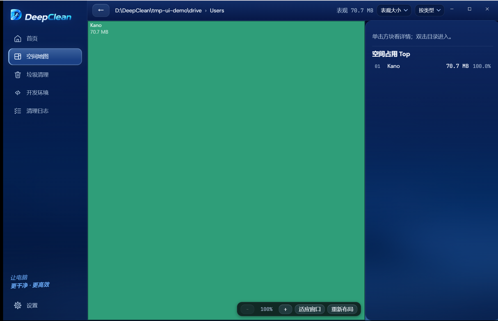
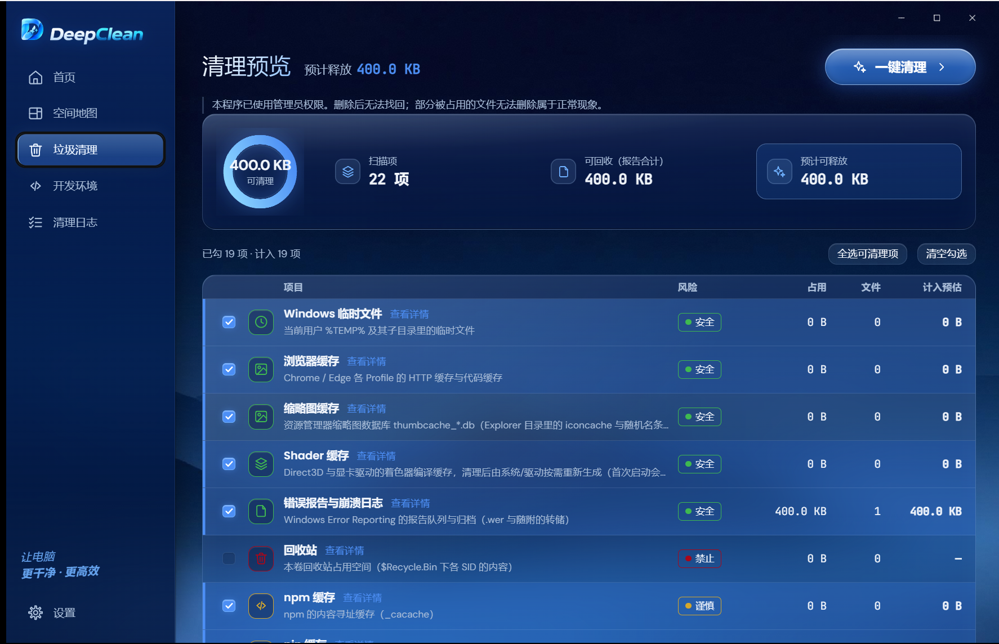
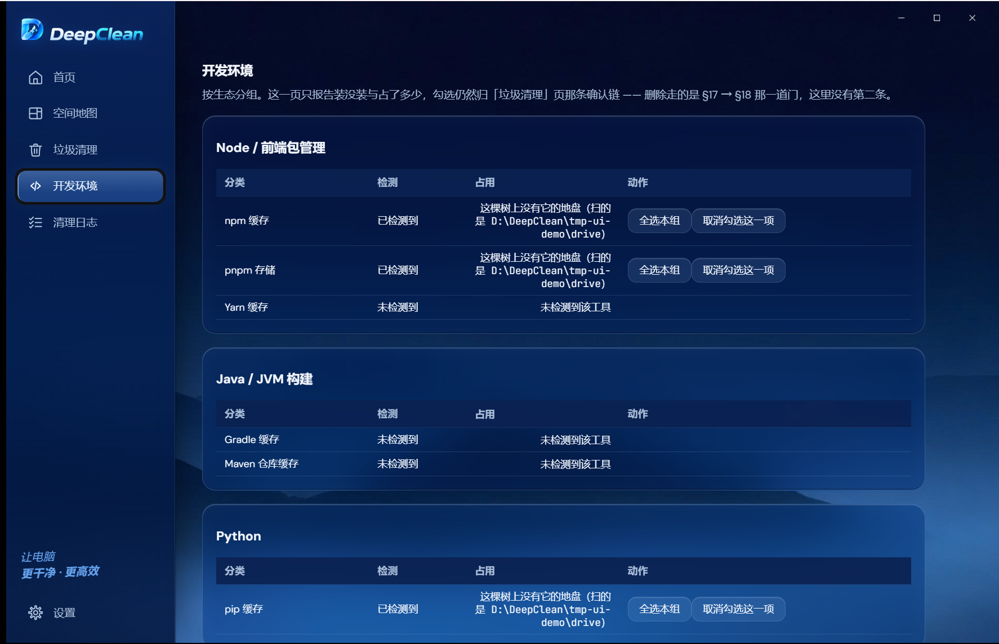
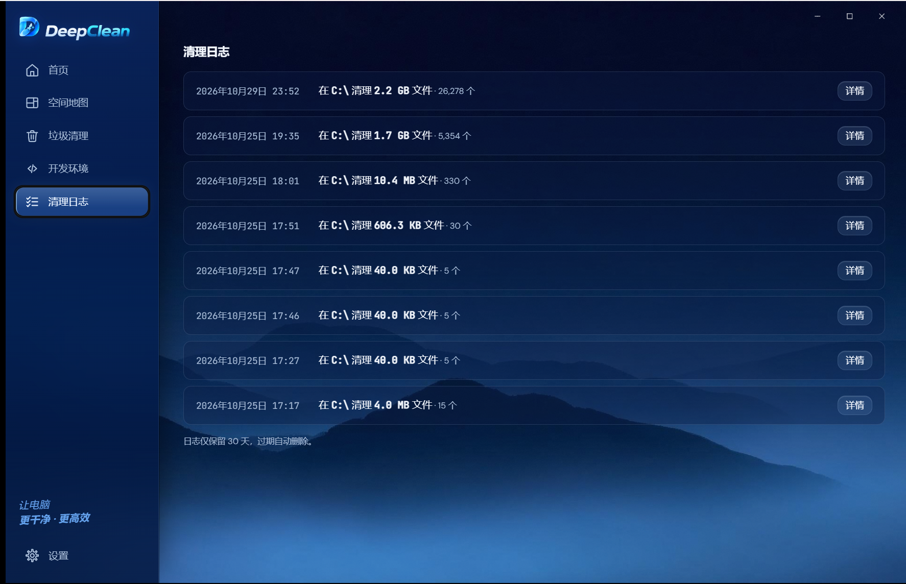

<div align="center">

# DeepClean

**Windows 磁盘空间分析与清理工具**

扫描一棵目录树，告诉你空间去哪了；再把可以删的东西逐项列出来。<br>
每一步都要你自己勾、自己确认，它才动手。

[](https://github.com/TihiroKano/DeepClean/releases)
[](LICENSE)
[](#)
[](https://tauri.app)
[](https://www.rust-lang.org)
[](https://github.com/TihiroKano/DeepClean/actions/workflows/ci.yml)

[下载安装包](https://github.com/TihiroKano/DeepClean/releases/latest) · [它怎么保证不乱删](#它怎么保证不乱删) · [从源码构建](#从源码构建)

</div>

## 目录

- [为什么又写一个清理工具](#为什么又写一个清理工具)
- [六个页面](#六个页面)
- [它怎么保证不乱删](#它怎么保证不乱删)
- [安装](#安装)
- [从源码构建](#从源码构建)
- [技术栈](#技术栈)
- [授权](#授权)
- [踩过的坑](#踩过的坑)
- [许可](#许可)

---

## 为什么又写一个清理工具

市面上的清理软件有个通病：**它替你决定删什么**。

「一键优化」按下去，屏幕转两圈，告诉你清出了 3.2 GB。至于那 3.2 GB 是缓存、是日志，
还是你昨天刚下的安装包 —— 你不看，它也不说。

这个项目反过来。它只做两件事：把空间去哪了**画出来**，把能清的东西**列出来**。
删不删、删哪些，由你按下去。整个界面里没有一个「一键优化」按钮。

首页上那句「扫描 ≠ 删除 · 清理须逐项确认」不是装饰，是这一页唯一的产品主张。

---

## 六个页面

### 首页


选盘、看占用、开始扫描。左边那个环是当前盘的已用比例，右边的「空间概览」把扫到的
内容按系统 / 应用 / 用户 / 其他四类摊开 —— 这个分类不是按扩展名猜的，是扫描时按
目录归属算的。

底下那张卡是「最近一次扫描」：什么时候扫的、扫了多少文件、发现多少可清理。
右下角「扫描范围」有两个选项，本地磁盘或者指定目录。

顶部那个切盘按钮是全窗唯一的换盘入口。窗口最小宽 1080，所以它在最窄的情况下也够点。

### 空间地图



树图。面积正比于占用，块越大占得越多。

- **双击进入**目录，左上角面包屑可以回退
- **单击**看右侧详情面板，那里有「空间占用 Top」列表
- 右上角可以切「表现大小」和「占用大小」——前者和资源管理器「大小」列同一套数，
  后者是实际分配的去重口径
- 底部工具条能缩放、适应窗口、重新布局

这张图上 Windows 目录显示 9.0 MB，是因为扫的是测试夹具，不是真的系统盘。

### 垃圾清理



按规则逐项列出来。每一项都有：名字、说明、风险等级、占用、文件数、勾选后计入多少。

- **风险分三档**：安全 / 谨慎 / 禁止。「禁止」的项（比如回收站、系统关键区域）
  勾选框根本不给，不是勾了再拦
- **勾选是即时计价的**：勾一个，顶部那个环和「预计可释放」立刻变
- **一键清理**在右上角，按下去还有一次确认弹窗

这张图里勾了 19 项，可释放 400.0 KB —— 数字小是因为扫的是 85 MB 的测试夹具。
在真实机器上这个数通常是几个 GB。

### 开发环境



这一页**只报告，不判定**。哪些工具装了、各自占多少、哪些缓存能清，
全部由主进程的 `core/rules/devenv-view.ts` 算好了送过来，渲染层只负责画。

所以你在这一页找不到一个 `if (ruleId === 'huggingface-cache')` ——
那种写法等于把判据散进界面，改一次界面就没一次。

几条硬规矩：

- 探测说没装的分类，写「未检测到」，不写 `0 B`（写 0 是在暗示「有但很小」）
- AI 模型那一行点不出「全选」（它是用户自己下的模型，不是缓存）
- Docker 行只有「查看」和一句要用户自己敲的命令，没有任何能触发删除的控件

这一页的勾选仍然归「垃圾清理」那条确认链，它没有第二条删除通道。

### 清理日志



一次清理一条，不是一文件一行。

```
2026年10月29日 23:52   在 C:\ 清理 2.2 GB 文件 · 26,278 个   [详情]
```

倒序，保留 30 天，过期自动删。点「详情」进独立页 —— 一次清理可能删掉两万多个文件，
塞进列表里会卡死。

日志落盘，重启还在。这一页是真实的历史记录，不是造的假数据。

### 设置


三块竖排卡片：**界面语言 → 性能 → 外观**，往下还有授权和关于。

**界面语言**五种：简体中文 / 繁體中文 / English / 日本語 / 한국어。切换即时生效，
不用重启。

**删除速率**是一排小方格。档位数等于本机逻辑核数 —— 每台机器自己的档，不是写死的五档。
默认档取核数的 60%，给机器留点余量。想拉满也行，实测拉满不会崩（内存几乎不涨），
只是那几秒别的程序少几个核。

**外观**：背景壁纸（内置一张，也能选本地图）、毛玻璃四格（模糊 / 饱和 / 亮度 / 透明度）。
这四格直接落到 CSS 变量上，拖一下当场变，不重启不刷新。

---

## 它怎么保证不乱删

这是这个项目花力气最多的地方。四道闸，每道都有判据钉着。

### ① 规则引擎只出建议，不执行

`core/rules/` 和 `crates/rules/` 都是纯函数 —— 输入一棵树，输出「这些可以删」。
它们没有任何文件系统写权限。判定层能脱离界面单独跑单测，喂假数据进去看它判什么。

现在有 23 条规则：Windows 临时文件、浏览器缓存、缩略图缓存、Shader 缓存、
错误报告、回收站、npm / pnpm / Yarn / pip / Maven / Gradle 缓存、HuggingFace 模型、
VS Code 缓存、崩溃转储、GPU 驱动残留、孤立应用数据……

### ② 预览 → 确认 → 执行是三段，中间不许跳

勾选之后服务端算一份报告（删了能释放多少、哪些有风险）；确认那一步**重新算一份，
不复用缓存** —— 回执是删除的授权凭据，必须基于当下这份机器事实；只有执行才碰磁盘。

### ③ 系统关键区域永不清理

`C:\Windows`、`System32`、驱动目录这类位置在规则里标 `forbidden`，界面上一律显示
「系统关键区域 · DeepClean 永不清理」，勾选框根本不出现。

### ④ 失败的条目逐条列出

删不掉的（被进程占用、只有 TrustedInstaller 能删）不会静默跳过 —— 界面上逐条点名，
而且**不计入「释放空间」**。那个数字只报真的删掉的。

> 实测：2167 个目标里 14 条被在跑的进程锁着、3 条只有 TrustedInstaller 能删。
> 提权也救不回来。所以界面上承诺的是「逐条列出」，不是「都能删掉」。

### 它不做的事

- **不联网上报**。扫描与清理全程离线，授权校验也是离线的
- **不自动清理**。没有定时任务，没有「检测到可清理就动手」的路径
- **不碰你没勾的东西**。删除动作只针对确认弹窗里列出的那一批

---

## 安装

从 [Releases](https://github.com/TihiroKano/DeepClean/releases/latest) 下载
`DeepClean_1.0.7_x64-setup.exe`（约 3.3 MB），双击安装。

**需要管理员权限。** 删系统目录里的垃圾需要它，所以 exe 的 manifest 是
`requireAdministrator`，从快捷方式启动会弹 UAC。

> ⚠️ **安装完成那一页，请把「运行 DeepClean」的勾去掉**，装完自己从桌面或开始菜单
> 的快捷方式启动。
>
> 因为 Tauri 的 NSIS 模板里，那个「运行」按钮走的是 `nsis_tauri_utils::RunAsUser` ——
> 它会**主动降权**成当前用户来启动，于是程序带着普通用户令牌跑起来，不弹 UAC。
> 这跟 manifest 声明的 `requireAdministrator` 是矛盾的：界面起来了，但清理系统目录
> 时会失败，而且失败原因看起来像「文件被占用」。
>
> 从快捷方式启动就正常了 —— 那条路走的是 Windows 的 shell 执行，会按 manifest 提权。
>
> （这是 2026-10-29 装机实测发现的。Tauri 2 没有提供关掉那个复选框的配置项，
> `installerHooks` 也只能插四个 `NSIS_HOOK_*` 宏、改不了 `RunMainBinary` 函数，
> 所以只能在这里写明。）

> ⚠️ **安装包未做代码签名**，首次运行会看到 SmartScreen 的「未知发布者」。
> 点「更多信息」→「仍要运行」。

**安装包不含 WebView2 离线运行时**，这是它只有 3.3 MB 而不是 212 MB 的原因。
Win11 自带；Win10 多数已经装了。真缺了，安装器会联网拉一个 bootstrapper 装上。

---

## 从源码构建

### 需要什么

| 依赖 | 版本 |
| --- | --- |
| Windows | 10 / 11 x64 |
| Node.js | ≥ 20.12 |
| Rust | 1.98（`x86_64-pc-windows-gnu` 工具链） |
| MinGW-W64 | gcc（GNU 工具链的链接器要用它） |
| WebView2 | Win11 自带；Win10 多数已装 |

### 三步

```powershell
git clone https://github.com/TihiroKano/DeepClean.git
cd DeepClean
npm install
npm run build:tauri        # 前端产物进 src-tauri/dist
npx tauri build --bundles nsis
```

产物：

```
src-tauri\target\release\deepclean-app.exe
src-tauri\target\release\bundle\nsis\DeepClean_1.0.7_x64-setup.exe
```

> **改了前端必须先 `build:tauri` 再 `cargo build`。** `cargo` 只盯 `src/` 和 `Cargo.toml`，
> 它不会因为 `dist/` 变了就重新嵌入 —— 不重打的话你跑的还是**旧页面**，
> 而这个症状看起来像「我改了 CSS 但没生效」。`build.rs` 里的
> `cargo:rerun-if-changed=dist` 就是为这条。

### 开发与测试

```powershell
npx tauri dev            # 热重载开发（Rust 工具链要在 PATH 里）
npm test                 # vitest，1133 条
cargo test --workspace   # 28 组，在 src-tauri/ 下跑
npm run typecheck        # tsc 两个项目
cargo check --release    # 比 npx tauri build 快得多，改了 Rust 先跑这个
```

---

## 技术栈

```
core/              纯 TS 判定层（扫描 / 规则 / 分析 / 清理 / 报告）
shared/            两端共用的类型与常量（只许 import 自己）
src/               React 渲染端（页面 / 组件 / 样式）
src-tauri/
  src/             Tauri 壳：命令、会话服务、设置、壁纸、协议注册
  crates/          六个不依赖 tauri 的纯 Rust crate，可单独 cargo test
    scanner/       MFT 与目录枚举
    rules/         规则引擎与判定
    cleaner/       删除执行
    license/       离线授权（Ed25519 + DPAPI）
    devenv/        开发环境识别
    appfacts/      机器事实探针
tests/             vitest 用例
scripts/           探针、对账、截图生成
```

**为什么 `core/` 和 `crates/` 都是纯的**：判定逻辑必须能在没有界面、没有窗口的情况下
被单测直接喂输入。`src-tauri` 那层只做 command / event 转发。

| | |
| --- | --- |
| TypeScript / TSX | 37,717 行（163 个文件） |
| Rust | 42,438 行（90 个文件） |
| 测试 | 1,133 条 vitest（76 个文件）+ 28 组 cargo |

扫描走的是 NTFS 的 MFT（主文件表）直读，不是递归遍历目录 —— 这是它比 `dir /s` 快
一个数量级的原因。拿不到 MFT 的时候（非 NTFS 卷、权限不足）回退到普通遍历。

---

## 授权

离线授权。激活码是 `DC-` 开头的字符串，在**设置 → 授权**里输入，全程不需要联网。

- 应用内嵌的是 **SHA-256 哈希清单**，从不解码回明文 —— 从哈希反推要猜中 128 位熵里的一个
- 设备绑定用 **Ed25519**，私钥由 **DPAPI** 保护后落盘，每台机器现场生成（`OsRng`）
- 源码里没有任何硬编码密钥

<details>
<summary><b>测试激活码（点开查看）</b></summary>

> 当前安装包内置的是**测试码表**（5 条），正式发放的码不随仓库分发。
> 下列任一码都能激活（大小写、首尾空格都行，输入时会自动归一化）：

```
DC-FIX-0001
dc-fix-0002
DC-fix-0003
DC-FIX-0004
DC-FIX-0005
```

> ⚠️ 这批是开发阶段的公开测试码：任何一台机器都能用同一个码激活，
> 而且没法从服务器端撤销（离线授权没有全局登记处）。正式发布时会换成预生成的
> 独立码表 —— 那份表不进仓库，按台发放。

</details>

---

## 踩过的坑

写在这里，省下一个人一天。

- **`Win32::UI::Controls::Dialogs` 不是 `Win32::UI::Shell`** —— `GetOpenFileNameW`
  在 `Shell` 下也有同名声明，照着名字导会报 `E0432` 解不出来。
- **调 `GetOpenFileNameW` 前必须 `CoInitializeEx`** —— Tauri 的 async 命令跑在线程池上，
  那上面的线程不保证初始化过 COM；不初始化时它回 0，而且原因说不清。
- **`tauri build` 和 `cargo build` 不是一回事** —— `#[cfg(debug_assertions)]` 门控的
  import 只在 release 档暴露。改完跑一次 `cargo check --release`，别拿十几分钟的打包
  当编译检查。
- **壁纸只存文件名，不存绝对路径** —— 存路径等于把「选一张图」变成「读任意文件」。
- **缓存键要放「已删集合的快照」而不是「非空」** —— 后者会让清理过一次之后缓存永久失效，
  此后每次勾选都重跑全量。
- **PowerShell 里 `"$var?name=x"` 是错的** —— `?` 是合法的变量名字符，`$var?` 会被当成
  一个变量名展开成空串。要写成 `"${var}?name=x"`。（CI 里挂 Release 资产那一步因此
  连红五次。）
- **`GET /releases/tags/{tag}` 对 draft 一律 404** —— 拿它当「存不存在」的判据，
  每次重跑都会再建一条，仓库里会堆一串同名空壳。

---

## 许可

**PolyForm Noncommercial License 1.0.0** —— 见 [LICENSE](LICENSE)。

| 你可以 | 你不可以 |
| --- | --- |
| 读源码 | **商用**（任何有商业预期的用途） |
| 自己用、研究、学习、实验 | 拿它做一个产品卖 |
| 改，改完自己用 | 改了之后分发出去卖 |
| 在非营利组织 / 学校 / 政府机构里用 | 把它并进商业产品 |

**这不是一个 OSI 认可的开源协议。** 这是刻意的：源码公开是为了让人能看见它做什么、
怎么做的，不是为了让人复制一份去卖。

字体（DM Sans / DM Serif / Poppins / JetBrains Mono）**是另一套许可**，
见 [`docs/fonts-LICENSE.txt`](docs/fonts-LICENSE.txt)。
