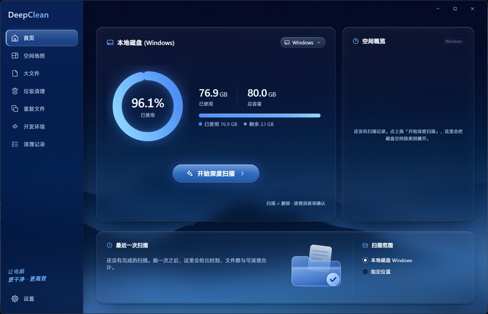
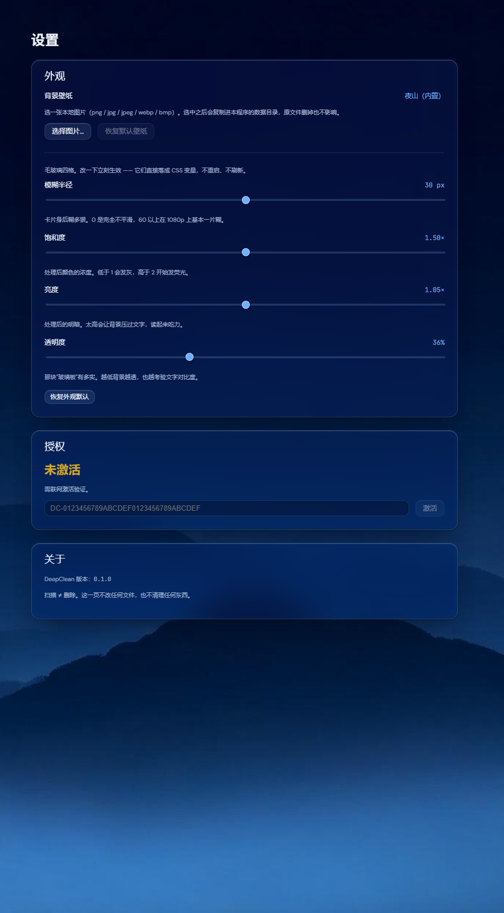

<div align="center">

# DeepClean

**Windows 磁盘空间分析与安全清理工具**

扫描一棵目录树，告诉你空间去哪了 —— 然后把可以删的东西逐项列出来，<br>
每一步都要你勾选、确认，才动手。

[](https://github.com/TihiroKano/DeepClean/releases)
[](LICENSE)
[](#)
[](https://tauri.app)
[](https://www.rust-lang.org)
[](https://github.com/TihiroKano/DeepClean/actions/workflows/ci.yml)

[下载安装包](https://github.com/TihiroKano/DeepClean/releases/latest) · [它怎么保证不乱删](#它怎么保证不乱删) · [从源码构建](#从源码构建)

</div>

## 为什么又造一个清理工具

市面上的磁盘清理工具有个共同的毛病：**它们替你决定删什么**。

DeepClean 反过来 —— 它只做两件事：把空间去哪了**画出来**，把可清理的东西**列出来**。
删什么、删不删，是你按下去的。整个交互里没有"一键优化"这种按钮。

<br clear="right" />

---

## 功能



| 页面 | 做什么 |
| --- | --- |
| **首页** | 选一个目录开始扫描，看进度、总量、按类别摊开的空间概览 |
| **空间地图** | 树图按占用面积铺格子，可钻取、右键选中、返回上一级、排除目录 |
| **垃圾清理** | 按规则逐项列出可清理项，勾选 → 看预估 → 确认 → 执行 |
| **开发环境** | 识别这台机器装过哪些开发工具与缓存（只读探测） |
| **清理日志** | 每次清理一条记录，落盘保留 30 天，点详情看删了哪些文件 |
| **设置** | 界面语言（5 种）、删除速率（点阵滑块，档位随 CPU 自适应）、壁纸、毛玻璃四格、授权、版本 |

### 它不做的事

- **不联网上报**。扫描与清理全程离线。
- **不自动清理**。没有任何定时任务、没有任何"检测到可清理就动手"的路径。
- **不碰你不勾的东西**。删除动作只针对确认弹窗里列出的那一批。

---

## 它怎么保证不乱删

这是这个项目花最多力气的地方。四道闸，每道都有判据钉着：

**① 规则引擎只出建议，不执行**
`core/rules/` 与 `crates/rules/` 是纯函数 —— 输入一棵树，输出"这些可以删"。它们没有任何
文件系统写权限。判定层能单独跑单测，喂假数据进去看它判什么。

**② 预览 → 确认 → 执行是三段，中间不许跳**
勾选之后服务端算一份报告（删了能释放多少、哪些有风险）；确认那一步重新算一份**不复用缓存**
（回执是删除的授权凭据，必须基于当下这份机器事实）；只有执行才碰磁盘。

**③ 系统关键区域永不清理**
`C:\Windows`、`System32`、驱动目录这类位置在规则里标 `forbidden`，界面上一律显示
「系统关键区域 · DeepClean 永不清理」，勾选框根本不出现。

**④ 失败的条目逐条列出**
删不掉的（被进程占用、只有 TrustedInstaller 能删）不会静默跳过 —— 界面上逐条点名，
且**不计入"释放空间"**。那句数字只报真的删掉的。

> 实测：2167 个目标里 14 条被在跑的进程锁着、3 条只有 TrustedInstaller 能删。
> 提权也救不回来 —— 所以界面上承诺的是「逐条列出」，不是「都能删掉」。

---

## 下载安装

从 [Releases](https://github.com/TihiroKano/DeepClean/releases/latest) 下载
`DeepClean_1.0.7_x64-setup.exe`（约 4.6 MB），双击安装。

**需要管理员权限** —— 删除系统目录里的垃圾需要它，所以 exe 的 manifest 是
`requireAdministrator`，从快捷方式启动会弹 UAC。

> ⚠️ **安装完成那一页请把「运行 DeepClean」的勾去掉，装完自己从桌面 / 开始菜单的
> 快捷方式启动。**
>
> 原因是 Tauri 的 NSIS 模板里那个「运行」按钮走的是 `nsis_tauri_utils::RunAsUser` ——
> 它**主动降权**成当前用户来启动，于是程序带着普通用户令牌跑起来、**不弹 UAC**。
> 那与 manifest 声明的 `requireAdministrator` 是矛盾的：界面起来了，但清理系统目录时
> 会失败，而且失败原因看起来像"文件被占用"。
>
> 从快捷方式启动就正常了 —— 那条路走的是 Windows 的 shell 执行，会按 manifest 提权。
>
> （这条是 2026-10-29 装机实测发现的。Tauri 2 没有提供关掉那个复选框的配置项，
> `installerHooks` 也只能插四个 `NSIS_HOOK_*` 宏、改不了 `RunMainBinary` 函数，
> 所以只能在这里写明。）

> ⚠️ **安装包未签名**，首次运行会看到 SmartScreen 的「未知发布者」。
> 点「更多信息」→「仍要运行」。

**安装包不含 WebView2 离线运行时**（这是它只有 4.6 MB 而不是 212 MB 的原因）。
Win11 自带运行时；Win10 多数已装。真缺了，安装器会联网拉一个 bootstrapper 装上。

---

## 从源码构建

### 需要什么

| 依赖 | 版本 |
| --- | --- |
| Windows | 10 / 11 x64 |
| Node.js | ≥ 20.12 |
| Rust | 1.98（`x86_64-pc-windows-gnu` 工具链） |
| MinGW-W64 | gcc（GNU 工具链的链接器要用它） |
| WebView2 | Win11 自带；Win10 多数已装 |

### 三步

```powershell
git clone https://github.com/TihiroKano/DeepClean.git
cd DeepClean
npm install
npm run build:tauri        # 前端产物进 src-tauri/dist
npx tauri build --bundles nsis
```

产物：

```
src-tauri\target\release\deepclean-app.exe
src-tauri\target\release\bundle\nsis\DeepClean_1.0.7_x64-setup.exe
```

> **改了前端必须先 `build:tauri` 再 `cargo build`**。`cargo` 只盯 `src/` 与 `Cargo.toml`，
> 它不会因为 `dist/` 变了就重新嵌入 —— 不重打的话你跑的还是**旧页面**，而这个症状看起来
> 像「我改了 CSS 但没生效」。`build.rs` 里 `cargo:rerun-if-changed=dist` 就是为这条。

### 开发与测试

```powershell
npx tauri dev            # 热重载开发（需要 Rust 工具链在 PATH）
npm test                 # vitest，1130 条
cargo test --workspace   # 28 组，在 src-tauri/ 下跑
npm run typecheck        # tsc 两个项目
```

---

## 版本历史

### 1.0.7（当前）

- **性能滑块改点阵样式**：一排小方格，已选的染蓝、色阶随档位加深，两端标注撤掉，
  读数换成 `x5` / `x8` 这种记号（默认档显示「默认推荐」）。
- **档位数 = 本机逻辑核数**（从系统取，每台机器自己的档）。
- **默认档 = 核数的 60%**：清理是瞬时突发负载，默认给机器留 40% 的核；想拉满随你，
  实测拉满不会崩（内存几乎不涨），只是别的程序那几秒少几个核。
- **上限弹窗取消**：实测证明拉高只会白等不会崩，弹窗在替不存在的问题道歉。
- 界面文案微调，五份词典同步。

### 1.0.5 – 1.0.6

- **真删通道从 shell 层换到内核层**（`SHFileOperationW` → `DeleteFileW`）：
  每千文件从 **27 秒降到 0.27 秒，约 100×**。17143 个文件的清理从 7.7 分钟进到 5 秒级。
- **带只读位的文件现在删得掉了**（旧版直接失败；缓存目录里大量这类文件）。
- **删除并发按批次切片**，线程数吃「删除速率」那一格的设置。
- 错误分类、`errno` 形状、重试语义与旧版逐字相同（同一张分类表）。

### 1.0.1 – 1.0.4

- 修首页切盘药丸点不动（`<label>` 包 `<select>` 的激活 bug）。
- 修换盘后首页仍显示旧盘占用（两处各算一遍"扫的是谁"）。
- 修清理后首页盘容量不刷新（`listDrives` 一辈子只读一次）。
- 首页首次进入显示盘容量（不再全 0）。
- 设置页重排：语言 → 性能 → 外观 → 授权 → 关于。
- 安装器界面改为中文；新增界面语言（简体 / 繁體 / English / 日本語 / 한국어）。

详细数据与过程记录见 [docs/benchmarks](docs/benchmarks) 与 [docs/acceptance](docs/acceptance)。

---

---

## 技术栈与结构

```
core/              纯 TS 判定层（扫描 / 规则 / 分析 / 清理 / 报告）
shared/            两端共用的类型与常量（只许 import 自己）
src/               React 渲染端（页面 / 组件 / 样式）
src-tauri/
  src/             Tauri 壳：命令、会话服务、设置、壁纸、协议注册
  crates/          六个不依赖 tauri 的纯 Rust crate，可单独 cargo test
    scanner/       MFT 与目录枚举
    rules/         规则引擎与判定
    cleaner/       删除执行
    license/       离线授权（Ed25519 + DPAPI）
    devenv/        开发环境识别
    appfacts/      机器事实探针
tests/             vitest 用例
scripts/           探针、对账、截图生成
```

**为什么 `core/` 与 `crates/` 都是纯的**：判定逻辑必须能在没有界面、没有窗口的情况下
被单测直接喂输入。`src-tauri` 那层只做 command / event 转发。

| | |
| --- | --- |
| TypeScript / TSX | 18,000 行（75 个文件） |
| Rust | 41,105 行（87 个文件） |
| 测试 | 1,130 条 vitest + 28 组 cargo |

---

## 授权

离线授权。激活码形如 `DC-` 开头的字符串，在**设置 → 授权**里输入，全程不需要联网。

- 应用内嵌的是 **SHA-256 哈希清单**，从不解码回明文 —— 从哈希反推需要猜中 128 位熵里的一个。
- 设备绑定用 **Ed25519**，私钥由 **DPAPI** 保护后落盘，**每台机器现场生成**（`OsRng`）。
- 源码里没有任何硬编码密钥。

<details>
<summary><b>测试激活码（点开查看）</b></summary>

> 当前安装包内置的是**测试码表**（5 条），正式发放的 1000 个码不随仓库分发。
> 下列任一码都可以激活（大小写、首尾空格均可，输入时会自动归一化）：

```
DC-FIX-0001
dc-fix-0002
DC-fix-0003
DC-FIX-0004
DC-FIX-0005
```

> ⚠️ 这批码属于开发阶段公开测试码：任何一台机器都能用同一个码激活，
> 且无法从服务器端撤销（离线授权没有全局登记处）。正式发布时会换成预生成的
> 独立码表 —— 那份表不进仓库，按台发放。

</details>



---

## 几条踩过的坑

写在这里，省下一个人一天。

- **`Win32::UI::Controls::Dialogs` 不是 `Win32::UI::Shell`** —— `GetOpenFileNameW` 在
  `Shell` 下也有同名声明，照着名字导会报 `E0432` 解不出来。
- **调 `GetOpenFileNameW` 前必须 `CoInitializeEx`** —— Tauri 的 async 命令跑在线程池上，
  那上面的线程不保证初始化过 COM；不初始化时它回 0 且原因说不清。
- **`tauri build` 与 `cargo build` 不是一回事** —— `#[cfg(debug_assertions)]` 门控的
  import 只在 release 档暴露。改完跑一次 `cargo check --release`，别拿十几分钟的打包当编译检查。
- **壁纸只存文件名不存绝对路径** —— 存路径等于把「选一张图」变成「读任意文件」。
- **缓存键要放「已删集合的快照」而不是「非空」** —— 后者会让清理过一次之后缓存永久失效，
  此后每次勾选都重跑全量。

---

## 许可

**PolyForm Noncommercial License 1.0.0** —— 见 [LICENSE](LICENSE)。

| 你可以 | 你不可以 |
| --- | --- |
| 读源码 | **商用**（任何有商业预期的用途） |
| 自己用、研究、学习、实验 | 拿它做一个产品卖 |
| 改，改完自己用 | 改了之后分发出去卖 |
| 在非营利组织 / 学校 / 政府机构里用 | 把它并进商业产品 |

**这不是一个 OSI 认可的开源协议。** 这是刻意的：源码公开是为了让人能看见它做什么、
怎么做的，不是为了让人复制一份去卖。

字体（DM Sans / DM Serif / Poppins / JetBrains Mono）**是另一套许可**，
见 [`docs/fonts-LICENSE.txt`](docs/fonts-LICENSE.txt)。
